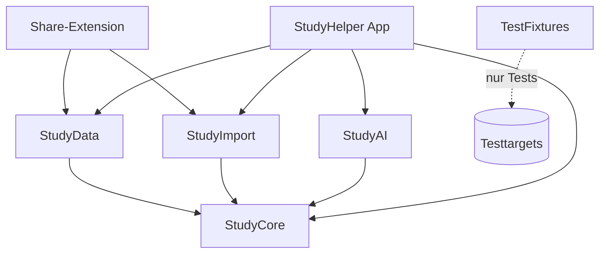

# StudyHelper – Architektur und Umsetzungsplan

Autorität für Anforderungen ist `docs/SPEC.md`. Dieses Dokument beschreibt, **wie** die Anforderungen technisch umgesetzt werden. Phasen: `docs/PHASES.md`, Entscheidungen: `docs/DECISIONS.md`, Geräteprüfungen: `docs/MANUAL_TESTS.md`.

## 1. Ziel und Leitplanken

StudyHelper digitalisiert Lernstoff (Fotos, handschriftliche PDFs, Goodnotes-Exporte, Mindmaps, Tabellen) einmalig, speichert ihn dauerhaft als Text inkl. Hervorhebungen, strukturiert ihn in Themen und fragt ihn mit KI-Unterstützung ab (Multiple Choice, Freitext, Chat, Karteikarten, gestufte Tipps, Leitner). Plattform: iOS 18+, iPhone und iPad, SwiftUI, SwiftData, Swift 6.

### Oberste Regel: „Nur Inhalte aus dem Lernstoff“

Die Regel hat Vorrang vor allem anderen und wird nicht nur per Prompt, sondern technisch durchgesetzt:

| Mechanismus | Umsetzung |
|---|---|
| Feste Prompt-Teile | Grundregel inkl. Lücken-Regel und Ausgabeformat (JSON-Schema bzw. Guided Generation) werden von der Prompt-Komposition (`StudyCore`) selbst angehängt. Nutzer-Prompts und Fach-Zusätze können sie weder ersetzen noch kürzen; im Editor erscheinen sie schreibgeschützt. Kurzvarianten für das Apple-Modell kürzen nur den editierbaren Teil. |
| Quellenprüfung über Lerneinheit-IDs | Die KI verweist nur auf IDs (z. B. `T3-B2`). Die Quellenprüfung (`StudyCore`) prüft, ob jede ID existiert und zum erlaubten Kontext gehört. Inhalte ohne gültige Quelle, die nicht als KI-Ergänzung markiert sind, erzeugen eine Warnung zur Überprüfung (und zählen in der Modellstatistik). |
| Status von KI-Ergänzungen | Jede Ergänzung hat Herkunft `aiSupplement`, Status `proposed` / `accepted` / `rejected`, Begründung (welche Lücke, warum). Auch angenommene Ergänzungen bleiben dauerhaft als KI-Ergänzung markiert. |
| Nicht bestätigte Ergänzungen nie verwenden | Der Kontext-Baustein filtert Einheiten mit Status `proposed`/`rejected` grundsätzlich heraus; Fragen, Karten, Tipps und Chat-Antworten entstehen nur aus Original-, Nutzer- und angenommenen Einträgen. Tools der KI (`hole_einheit` usw.) liefern dieselbe gefilterte Menge. |
| Wortabgleich sortierte Fassung | Die sortierte Fassung darf nichts hinzufügen oder weglassen. `StudyCore` vergleicht die Wortmengen von Originaltext und sortierter Fassung; Abweichungen müssen vom Nutzer bestätigt werden. |
| Schalter | Lückenfüllen ist in den Einstellungen abschaltbar (dann nur Hinweis). Die Grundregel selbst nicht. |

Weitere Leitplanken: Digitalisierung läuft einmalig, alle späteren Schritte nutzen den gespeicherten Text (keine erneute Erkennung ohne ausdrücklichen Wunsch); Nutzerkorrekturen haben Vorrang vor automatischer Erkennung; Keys nur in der Keychain; Tests rufen nie echte APIs auf.

## 2. Modulaufteilung

```
StudyHelper (App-Target, SwiftUI)          StudyHelperShare (Share-Extension, ab Phase 1)
        │                                            │
        ├────────────► StudyAI ──────────┐           │
        ├────────────► StudyImport ──┐   │           │
        ├────────────► StudyData ──┐ │   │           │
        │                          ▼ ▼   ▼           │
        └──────────────────────► StudyCore ◄─────────┘
                                   (nur Foundation)

TestFixtures (nur Tests / make-fixtures) ──► kein Produktivcode hängt daran
```



Regel: Abhängigkeiten zeigen nur nach unten zu `StudyCore`. `StudyCore` kennt weder SwiftData, UIKit/SwiftUI, Vision, PDFKit noch Netzwerk.

| Modul | Inhalt | Status |
|---|---|---|
| **App-Target `StudyHelper`** | SwiftUI, Navigation, Einstellungen, View-Modelle; keine Fachlogik. Default-Actor-Isolation MainActor. | vorhanden (Phase 0, Platzhalter) |
| **Share-Extension** | Annahme von PDFs aus Goodnotes („Teilen → Exportieren → PDF“), App Group | geplant, Phase 1 |
| **`StudyCore`** (Package) | Nur Foundation: Wortabgleich sortierte Fassung, kompaktes Kontextformat (Markdown mit IDs), Kontext-Zusammenstellung mit Token-Budget, Leitner, Prompt-Komposition (feste Teile, Platzhalter), robustes JSON-Parsing, Quellenprüfung, Preisberechnung | Gerüst vorhanden (Phase 0), Inhalte ab Phase 1–7 |
| **`TestFixtures`** (Package, nur Tests) | PDF-Writer, synthetische Goodnotes-PDFs, Ground-Truth-JSON; Executable `make-fixtures` | vorhanden (Phase 0) |
| **`StudyData`** (Package) | SwiftData-Modelle und Repositories (Ort final in Phase 1, siehe DECISIONS) | geplant, Phase 1 |
| **`StudyImport`** (Package) | PDFKit/CGPDF-Zugriff, Goodnotes-Parser (Ink-/FreeText-/Stamp-Annotationen, Format-Erkennung, Zuordnung), Vision-Texterkennung, eingebetteter PDF-Text, digitale Seite (PDF mit Textebene), Bildanalyse für Hervorhebungen | vorhanden (Phase 1; digitale Seite und Bildanalyse Phase 3) |
| **`StudyAI`** (Package) | Anbieter-Protokoll, Mock-Modell, Claude, OpenAI, OpenAI-kompatibel, Apple Foundation Models (`#available(iOS 26, *)`), später MLX; Keychain-Speicher | geplant, ab Phase 2 (MLX Phase 9) |

`StudyCore`-Targets sind plattformneutral und laufen mit `swift test` direkt auf dem Mac (macOS 15 als zusätzliche Package-Plattform, siehe DECISIONS).

## 3. Datenfluss

```
Import ──► Quelle (Bild / PDF-Seite)
              │  (einmalig, direkt nach dem Import)
              ▼
        Digitalisierung
          · Originaltext (Markdown, wortgetreu, Reihenfolge der Vorlage)
          · Zeilen: Bounding Box + Sicherheit + Kandidaten
          · Hervorhebungen (Art, Farbe, Position, Sicherheit, Bedeutung)
          · Methode (Vision / eingebetteter Text / KI-Modell), Vision-Revision, iOS, Gerät, Zeitpunkt
          · Versionen, Nutzerkorrekturen
              ├──► Digitale Seite (PDF: Originalseite + unsichtbare Textebene; abgeleitet, immer neu erzeugbar;
              │    Ansichtsmodus und Seitenvorlage für KI-Aufgaben, D-037)
              ▼
        Sortierte Fassung (KI; Abschnitte mit Verweisen auf Originalstellen; Wortabgleich)
              ▼
        Themen (feste Struktur; Einträge mit Herkunft / Quelle / Hervorhebung / Ergänzungsstatus)
              ▼  (bei Bestätigung des Themas erzeugt, bei jeder Änderung aktualisiert)
        Lerneinheiten mit IDs („T3-B2“) · Kurzfassung je Thema · Suchindex + Embeddings
              ▼
        Lernen: Fragen / Karten mit Herkunfts-IDs · gestufte Tipps · Leitner-Fächer
              ▼
        Auswertung (pro Session, Thema, Schwierigkeit; Wiederholung)
```

Quellenverweise führen immer bis zum Originaltext und zur Position im Bild. Strukturierung nutzt die sortierte Fassung, falls vorhanden, sonst den Originaltext.

### Domänen-Entitäten

| Entität (Typname) | Zweck |
|---|---|
| Fach (`Subject`) | Fach wie Mathe/Deutsch; hält Farblegende, optionalen Prompt-Zusatz, `customWords` |
| Import (`Import`) | Ein Importvorgang (Fotos, PDF, Scan, Goodnotes-Export), Format, Zuordnung zweier Goodnotes-Exporte |
| Quelle (`Source`) | Einzelne Seite bzw. einzelnes Bild als Original, Basis für Bildhervorhebung |
| Digitalisierung (`Digitization`) | Gespeicherter Originaltext einer Quelle samt Methode, Vision-Revision, iOS/Gerät, Version |
| Zeile (`TextLine`) | Textzeile mit Bounding Box, Sicherheit, Kandidaten, Status unsicher/unleserlich |
| Hervorhebung (`Highlight`) | Hervorgehobener Text mit Art, Farbe, Position, Sicherheit, vermuteter Bedeutung |
| SortierteFassung (`OrganizedText`) | Logisch geordnete Fassung mit Abschnitten und Verweisen auf Originalstellen; versioniert |
| Thema (`Topic`) | Feste Struktur: Titel, Zusammenfassung, Kernaussagen, Begriffe, Formeln, Beispiele, Tabellen, Quellen, Herkunft |
| Eintrag (`TopicEntry`) | Einzelner Inhalt eines Themas mit Herkunft, Quellenverweis, Hervorhebung, Ergänzungsstatus/-begründung |
| Lerneinheit (`LearningUnit`) | Abfragbare Einheit mit stabiler ID, Text, Leitner-Fach, vorberechneter Token-Anzahl, Embedding |
| Frage (`Question`) | MC-/Freitext-Frage mit Schwierigkeit, Herkunfts-IDs, gespeicherten Tipps |
| Karte (`Flashcard`) | Karteikarte mit Herkunfts-IDs und Leitner-Fach |
| Tipp (`Hint`) | Gestufter Tipp (Stufe 1–n) zu einer Frage |
| Lernsession (`StudySession`) | Auswahl, Modus, Ergebnisse, Tipp-Anzahl, Chat-Verlauf |
| Anfrage-Log (`RequestLog`) | Protokoll einer KI-Anfrage (Metadaten, Prompt, Antwort; Header maskiert) |
| Preistabelle (`PriceEntry`) | Preise pro Modell (Input/Output/Cache je 1 Mio. Tokens), editierbar |
| PromptVorlage (`PromptTemplate`) | Editierbarer Teil des System-Prompts je Aufgabe, Fach-Zusätze, Export/Import |

## 4. Skizze des Anbieter-Protokolls

Illustrativ, **nicht verbindlich**. Die genauen API-Parameter (Modellliste, Reasoning, Usage-Angaben, Streaming) werden in Phase 2 der aktuellen offiziellen Dokumentation von Anthropic und OpenAI entnommen, nicht aus dem Gedächtnis.

```swift
struct ProviderCapabilities: Sendable {
    var supportsImages: Bool
    var supportsTools: Bool
    var supportsStreaming: Bool
    var reasoningLevels: [ReasoningLevel]   // leer = Modell ohne Reasoning
    var contextSize: Int?                   // Tokens, falls bekannt
}

enum ReasoningLevel: Sendable { case off, low, medium, high }

struct PromptParts: Sendable {
    var fixed: String        // Grundregel + Ausgabeformat, von der App angehängt, nicht editierbar
    var editable: String     // Standard- oder Nutzertext inkl. Fach-Zusatz, Platzhalter gefüllt
}

struct ModelRequest: Sendable {
    var system: PromptParts
    var messages: [ChatMessage]
    var images: [ImagePayload]
    var tools: [ToolDefinition]
    var responseSchema: ResponseSchema?     // JSON-Schema bzw. Guided Generation
    var reasoning: ReasoningLevel
    var learningUnitIDsInContext: [String]
}

struct ResponseMetadata: Sendable {
    var provider: String
    var model: String
    var reasoning: ReasoningLevel
    var inputTokens: Int?
    var outputTokens: Int?
    var cacheTokens: Int?
    var reasoningTokens: Int?
    var duration: Duration
    var timeToFirstToken: Duration?
    var sentContent: Set<SentContent>       // .image, .text
    var toolCalls: [ToolCallRecord]
    var learningUnitIDsInContext: [String]
    var rawPrompt: String                   // nur für Developer-Modus; Header nie enthalten
    var rawResponse: String
    var parsingError: String?
}

struct ModelResponse: Sendable {
    var text: String
    var metadata: ResponseMetadata
}

enum ModelEvent: Sendable {
    case textDelta(String)
    case toolCall(ToolCallRecord)
    case finished(ModelResponse)
}

protocol ModelProvider: Sendable {
    var capabilities: ProviderCapabilities { get }
    func respond(to request: ModelRequest) async throws -> ModelResponse
    func stream(_ request: ModelRequest) -> AsyncThrowingStream<ModelEvent, Error>
}
```

Der Rest der App kennt nur `ModelProvider`; Mock-Modell (feste Antworten), Claude, OpenAI, OpenAI-kompatibel, Apple Foundation Models und später MLX sind Implementierungen. Die Metadaten speisen Anfrage-Log, Preisberechnung und Developer-Modus einheitlich.

## 5. Teststrategie

| Ebene | Werkzeug | Ort |
|---|---|---|
| Unit-Tests | Swift Testing (`@Test`, deutsche `displayName`) | `swift test` auf dem Mac für Package-Logik (`StudyCore`, Parser, Fixtures); Simulator für App- und iOS-spezifische Tests |
| UI-Tests | XCTest (nur hier) | Simulator (`StudyHelperUITests`) |
| KI | Mock-Modell mit festen Antworten; **nie echte APIs oder Modelle in Tests** | überall |
| Goodnotes | Synthetische PDFs mit Ground-Truth-JSON (`TestFixtures`); keine echten Exporte im Repo | Package-Tests |
| Vision-Genauigkeit | Echtes Gerät (iOS-27-Regression tritt nur auf Geräten auf, nicht im Simulator) | `docs/MANUAL_TESTS.md` |
| Apple Intelligence, Kamera, Dokumentenscanner, iOS-18-Laufzeit | Nur Gerät | `docs/MANUAL_TESTS.md` |

Grenzen der Umgebung: Simulatoren nur iOS 27.2, keine iOS-18-Runtime; Mindestversion wird über `#available`-Pfade und eine Prüfung auf Gerät abgesichert (siehe DECISIONS).

## 6. Sicherheit und Datenschutz

- API-Keys ausschließlich in der Keychain, nie in UserDefaults, Code oder Logs.
- Anfrage-Logs maskieren Header (Authorization, `x-api-key` usw.); der Developer-Modus zeigt nie Keys.
- Keine Secrets, Tokens oder persönlichen Daten im Repository; `scripts/check-secrets.sh` prüft getrackte Dateien und läuft in `scripts/test.sh`.
- Eigene echte Goodnotes-Exporte liegen in `LocalSamples/` (gitignored), nie im Repo.
- Tests verwenden nur Mock-Modelle.

## 7. Arbeitsweise

- Umsetzung in Phasen laut `docs/PHASES.md`; pro Phase ein Commit, erst nach Verifikation (Checkboxen werden nach der Prüfung abgehakt).
- Aktueller Stand (fertig / in Arbeit / nächster Schritt) steht in `CLAUDE.md` und wird vor Kontextende bzw. Sitzungsende aktualisiert.
- Entscheidungen und offene Punkte werden in `docs/DECISIONS.md` protokolliert; Änderungen an Anforderungen zusätzlich in `docs/SPEC.md` nachvollziehbar.
- Lokale Skripte: `scripts/bootstrap.sh`, `build.sh`, `test.sh`, `make-fixtures.sh`, `check-secrets.sh`.
- Veröffentlichen (D-045): Bei Änderungen an der App zuerst die Version erhöhen (`scripts/bump-version.sh`) und den noch ungetesteten Stand mit `scripts/nightly-release.sh` als Nightly veröffentlichen (rollendes Pre-release `nightly`, Source-Eintrag „StudyHelper Nightly“), damit der Entwickler sofort auf dem Gerät testen kann. Danach `scripts/test.sh --ui`, Commit und `scripts/publish.sh` (getestete Beta, D-028). Ändert sich nach der Nightly noch etwas an der App, vor dem Commit erneut `bump-version.sh`.
- Arbeit mit Agenten: Aufgaben, die nicht voneinander abhängen, laufen **parallel** (z. B. Package-Logik und KI-Anbieter); nur Aufgaben, die auf dem Ergebnis einer anderen aufbauen, laufen nacheinander. Parallele Agenten arbeiten jeweils in einem eigenen Git-Worktree (eigene Builds, kein fremder halbfertiger Code, kein gemeinsamer Simulator), mit getrennten Dateien; sie committen nicht. Die Hauptsitzung führt die Ergebnisse zusammen, testet alles gemeinsam (`scripts/test.sh --ui`) und committet. Danach dürfen keine Prozesse oder gebooteten Simulatoren übrig bleiben.
